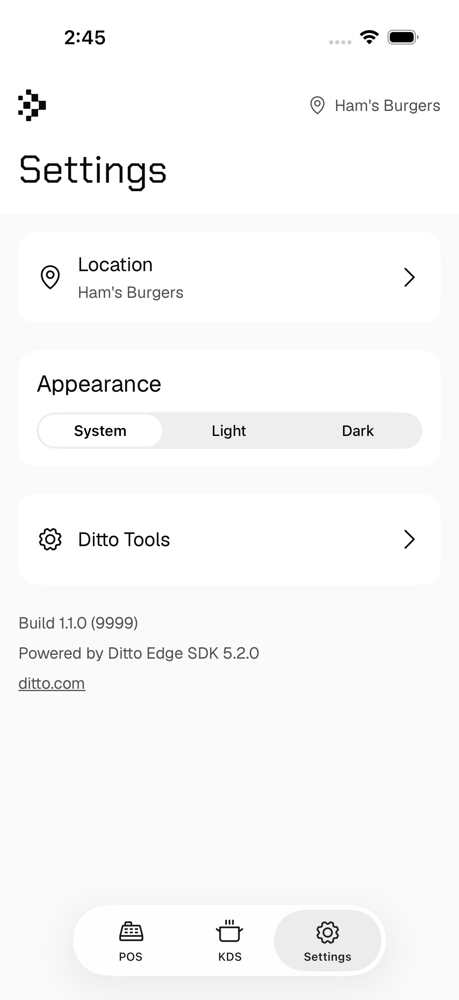
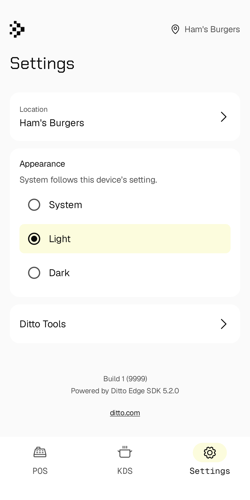

# DittoPOS

## Overview

A demo Point-of-Sale + Kitchen Display System for a quick service restaurant
chain. Customer orders are entered in the POS view and appear in real time on
the KDS view as they move through the kitchen workflow.

The UI has three tabs:

- **POS** — order entry and payment for the currently selected location.
- **KDS** — orders the kitchen is currently preparing (`inProcess`) or has
  finished (`processed`) for the currently selected location.
- **Settings** — location selection, System/Light/Dark appearance and Ditto Tools.

The app runs on iOS and Android and the two platforms sync with each other
over Ditto.

For support, please contact Ditto Support (<support@ditto.com>).

## Running the apps

See the README in the `iOS` or `Android` folders for build instructions.

App Store builds:
[iOS](https://apps.apple.com/us/app/ditto-pos/id6449074700) ·
[Google Play](https://play.google.com/store/apps/details?id=live.ditto.pos)

## Local build and test checks

Run the native commands from the repository root:

```sh
xcodebuild test -project iOS/DittoPOS.xcodeproj -scheme DittoPOS \
  -destination 'platform=iOS Simulator,name=iPhone 17 Pro,OS=26.5' \
  -derivedDataPath build/tests CODE_SIGNING_ALLOWED=YES CODE_SIGN_IDENTITY=- DEVELOPMENT_TEAM=

DITTO_ENV_FILE="$PWD/.ci/build.env" Android/gradlew -p Android \
  :app:testDebugUnitTest :ditto-wrapper:testDebugUnitTest :app:assembleDebug

# With an Android emulator already running; replace the serial with yours.
ANDROID_SERIAL=emulator-5554 DITTO_ENV_FILE="$PWD/.ci/build.env" \
  Android/gradlew -p Android :app:connectedDebugAndroidTest
```

iOS needs Xcode with an installed arm64 iOS Simulator; adjust the destination
to match your machine. Android needs JDK 17 and Android SDK Platform 37.

Tests that exercise storage and observers use the real Ditto SDK with isolated,
disposable offline stores, following [Ditto's testing guidance](https://docs.ditto.live/sdk/latest/deployment/testing).
These stores use no encryption/private key or license token and never start sync.
Simulate peer-originated changes with sequenced DQL writes to the local test store.
Real peer convergence and file transfer have separate manual acceptance checks.

The iOS `DittoPOSTests` bundle compiles production logic directly and uses the
small `DittoUIHost` for native SwiftUI lifecycle checks, without the demo app or
its `.env`. `DittoUIPresentationTests` uses XCUITest with the same host to exercise
the real theme, shell and Settings presentation. The host's startup has no Ditto
SDK, repositories or demo startup; offline stores are opened only by tests.
Android uses JVM logic
tests and emulator-based repository/UI tests whose runner substitutes a plain
`Application`, bypassing the demo's Hilt startup, seeding and sync. Both platforms
load the same independently authored order JSON from `Tests/Fixtures` for store
tests. `.ci/build.env` supplies placeholder constants for Android app compilation
only. These commands never launch the real demo apps and need no Ditto
authentication or app-store signing credentials. Add production logic to the
standalone target's Sources phase when extending its coverage; do not copy it.

Local and CI check builds use build number **9999**. Actual release builds
can supply `CURRENT_PROJECT_VERSION=<number>` to `xcodebuild` or
`-PdittoBuildNumber=<number>` to Gradle. These inputs do not change the
marketing version or allocate a shipping number.

## Settings

Settings contains the location picker, a device-local System/Light/Dark appearance
choice and the imported Ditto Tools. Version/build and SDK information come from
the running app.




## Native UI libraries

`iOS/DittoUI` is a local Swift package; `Android/ditto-ui` is a Compose library.
They own semantic styling, shared presentation components and bundled brand
resources, with no Ditto, navigation or app-state dependencies. App code supplies
values, bindings, callbacks and content. Package publication is separate work.

Open `ComponentCatalog.swift` in Xcode Canvas or `ComponentCatalog.kt` in Android
Studio Preview to inspect the actual shared controls in light/dark and large text.
The app-owned `SettingsContent` / `SettingsScreen` compose these foundations;
previews and the isolated UI hosts are developer resources, not app destinations.

`PhotoCatalog.swift` and `PhotoCatalog.kt` preview shared photo containers and
placeholders at phone and tablet sizes. The app-owned `ProductPhotoView` /
`ProductPhoto` load optional Ditto attachments, cancel loading when hidden and
reuse a bounded decoded-image cache. Offline tests cover photo replacement,
removal, delayed file availability and crop/export logic. Crop geometry uses
shared cases from `Tests/Fixtures/photo-crops.json` on both platforms.

## Data model

The demo follows current Ditto guidance for denormalized documents and
read-time conflict resolution. The whole order — cart, payments, status
history — lives in a single `pos_orders` document, which avoids cross-document
joins and lets Ditto's map-merge semantics resolve concurrent edits cleanly.

Collections:

- **`pos_orders`** — one document per order. Embedded fields:
  - `cart: Map<String, CartLineItem>` — line items keyed by a stable
    line-item id so adds and removes from different devices don't conflict.
  - `payments: Map<String, Payment>` — payments keyed by payment id.
  - `status_log: Map<String, String>` — ISO 8601 timestamp → status string.
    The "current" status is *derived* at read time using "most-advanced state
    wins" (`open` → `inProcess` → `processed` → `delivered`, with `canceled`
    as terminal). A stale device that comes online late and writes an older
    state cannot regress the order — the older entry stays in the log for
    auditability but the read-time derivation ignores it. See the
    [conflict-resolution-patterns guide](https://docs.ditto.live/best-practices/conflict-resolution-patterns).
  - `createdAt: ISO 8601 string` — used for the per-location TTL subscription
    and launch-time eviction.

- **`sale_items`** — synced menu items, one document per item per location.
  Hand-curated demo data is seeded once on first launch via
  `INSERT INTO ... INITIAL DOCUMENTS (...)` (idempotent, peer-safe).
  The optional `image` attachment is prepared for the image migration; current
  menu seeding and display still use `imageName` until that cutover. Missing or
  pending attachment files use a generic photo placeholder in the new renderer.

- **`locations`** — one document per location.

Documents in `pos_orders` and `sale_items` use a composite `_id` of
`{ id, locationId }`. Putting `locationId` inside `_id` lets Ditto use it as
the document's natural key for sync grouping/routing, and lets DQL filter by
`_id.locationId` without a secondary index. See the
`DocumentID` type in either platform's source.

### Schema migration

Current orders use the `pos_orders` collection. Legacy `orders` and
`transactions` documents are no longer read or written by the app.

## App features

### Location selection

The app ships with seven hand-curated demo restaurant locations. Pick one on
first launch; open Settings → Location to switch later.

The selected location's numeric id is used as Ditto's `syncGroup`, so only
devices at the same location form a peer-to-peer mesh. See the
[sync groups](https://docs.ditto.live/sdk/latest/sync/creating-sync-groups)
docs.

### Order workflow

A new order is created when you select a location or pay an existing one,
starting with status `open`. Adding the first item moves it to `inProcess`
and it becomes visible in the KDS view across the mesh.

In KDS, tap an `inProcess` (blue) order to advance it to `processed` (green).
Tap a `processed` order to mark it `delivered`, which removes it from the
view. A double-dollar-sign on the order border indicates payment.

Because the KDS view shows every device's orders for the current location,
multiple peers running the same demo concurrently will each see the others'
orders. Order status changes by tap from any device.

### "Paid" check

The order document has no `paid` field — an order is paid when its `payments`
map has at least one entry. To find paid orders in the portal data browser:

```
_id.locationId == '00001' && length(keys(payments)) > 0
```

### Time-based eviction

On launch, gated to once per 24h, the app evicts local orders older than the
start of the current day. Subscriptions filter the same way, so the local
store stays bounded over time.

## Scripts

Scripts in `scripts/` exercise insert/observer paths for metric testing. Each
script's header documents its purpose and inputs.

To run a script you'll need:

1. A [Cloud URL endpoint](https://docs.ditto.live/cloud/http-api/getting-started#cloud-url-endpoint).
2. An [HTTP API key](https://docs.ditto.live/cloud/http-api/auth-and-params#api-key).

Available:

- `INSERT_Orders` — inserts generic orders on a configurable interval.
