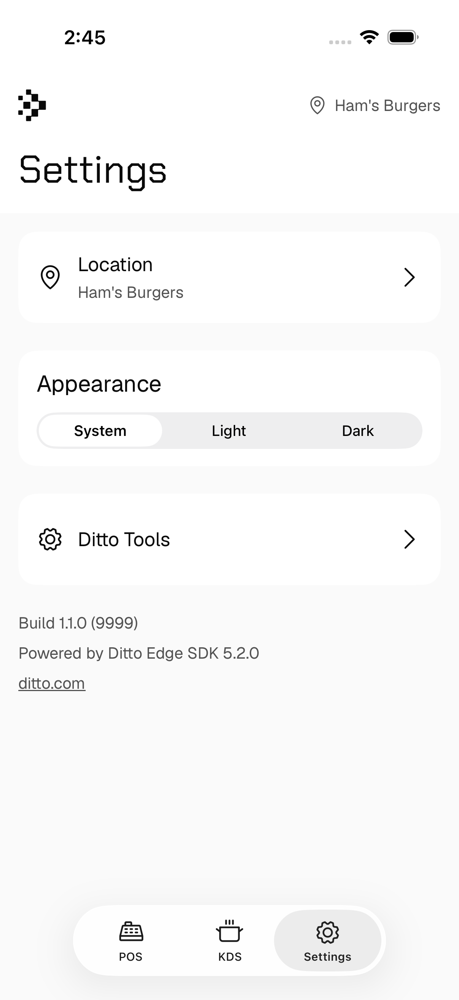
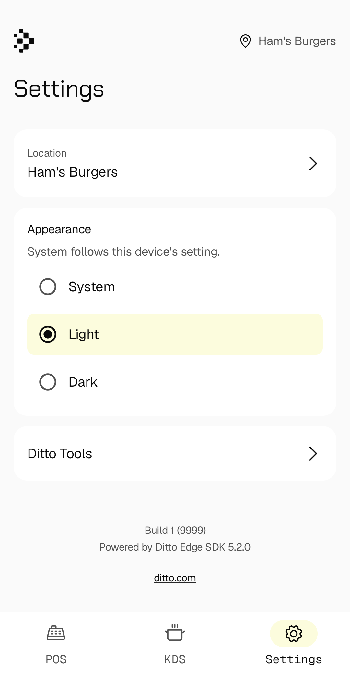
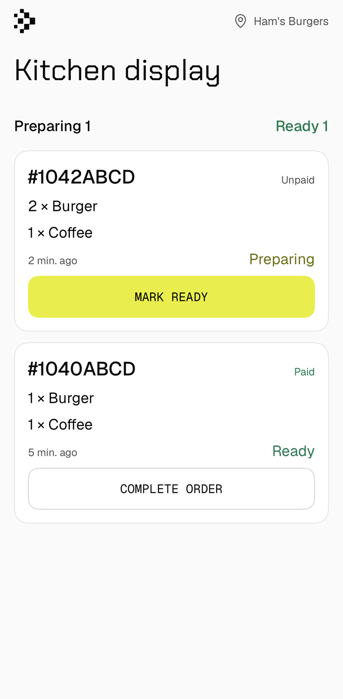
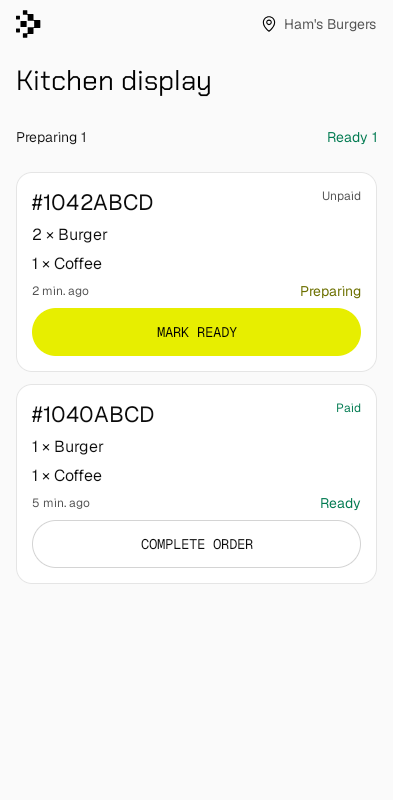
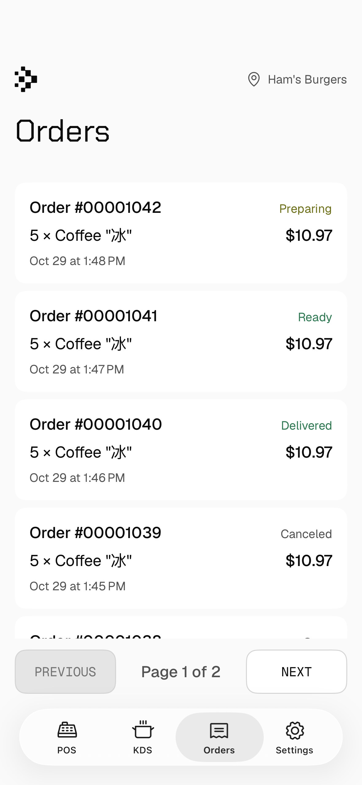
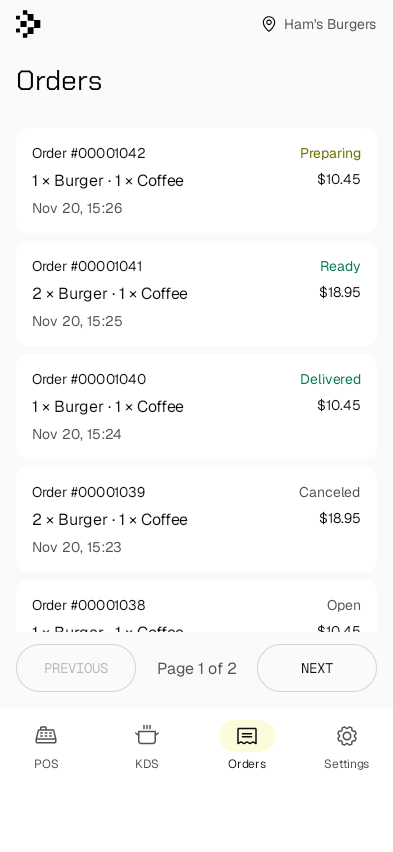
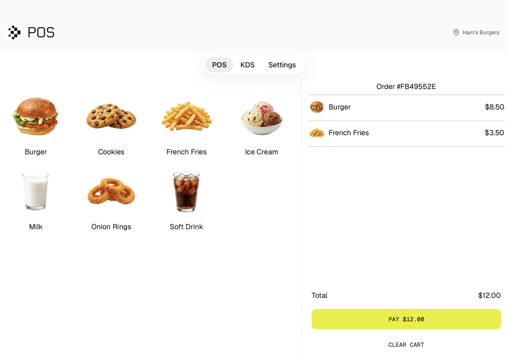
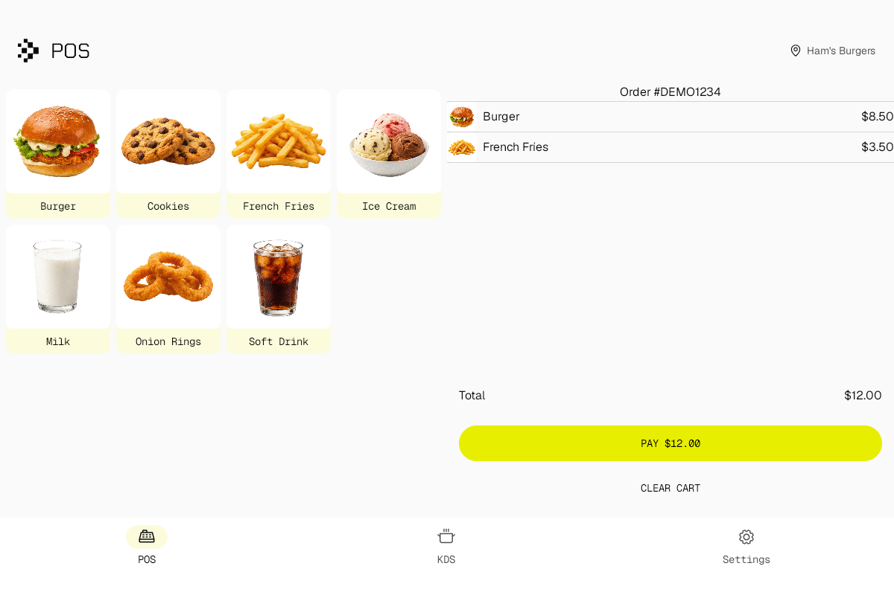

# DittoPOS

## Overview

A demo Point-of-Sale + Kitchen Display System for a quick service restaurant
chain. Customer orders are entered in the POS view and appear in real time on
the KDS view as they move through the kitchen workflow.

The UI has four tabs:

- **POS** — order entry and payment for the currently selected location.
- **KDS** — orders the kitchen is currently preparing (`inProcess`) or has
  finished (`processed`) for the currently selected location.
- **Orders** — a live, paginated list of nonempty orders stored on this device
  for the currently selected location.
- **Settings** — location selection, System/Light/Dark appearance and Ditto Tools.

The app runs on iOS and Android and the two platforms sync with each other
over Ditto.

For support, please contact Ditto Support (<support@ditto.com>).

## Running the apps

See [iOS](iOS/README.md) or [Android](Android/README.md) for platform build instructions.
[Test and preview guidance](docs/testing.md) covers automated checks and developer tools.

App Store builds:
[iOS](https://apps.apple.com/us/app/ditto-pos/id6449074700) ·
[Google Play](https://play.google.com/store/apps/details?id=live.ditto.pos)

## Settings

Settings contains the location picker, a device-local System/Light/Dark appearance
choice and the imported Ditto Tools. Version/build and SDK information come from
the running app.




## Kitchen display

Phones show full-width tickets. Tablets separate Preparing and Ready into two
columns, with a bounded empty state only when the other stage has tickets.
Use **Mark ready** and **Complete order** to advance tickets; payment is shown
separately and does not gate the kitchen workflow.




## Orders

Orders shows recorded items, workflow state, date and total, newest first, with
50 orders per page. The list and page count update as orders change.

Empty carts are excluded from both queries. Paid, unpaid and zero-total orders
are included while locally stored. This view uses the existing subscription and
eviction policies; it does not fetch older history.




## Data model

The demo follows current Ditto guidance for denormalized documents and
read-time conflict resolution. The whole order — cart, payments, status
history — lives in a single `pos_orders_v2` document, which avoids cross-document
joins and lets Ditto's map-merge semantics resolve concurrent edits cleanly.

Collections:

- **`pos_orders_v2`** — one document per order. Embedded fields:
  - `cart: Map<String, CartLineItem>` — line items keyed by a stable
    line-item id so adds and removes from different devices don't conflict.
  - `payments: Map<String, Payment>` — payments keyed by payment id.
  - `status_log: Map<String, String>` — ISO 8601 timestamp → status string.
    The "current" status is *derived* at read time using "most-advanced state
    wins" (`open` → `inProcess` → `processed` → `delivered`, with `canceled`
    as terminal). A stale device that comes online late and writes an older
    state cannot regress the order — the older entry stays in the log for
    auditability but the read-time derivation ignores it. See the
    [conflict-resolution-patterns guide](https://docs.ditto.live/best-practices/conflict-resolution-patterns).
  - `createdAt: ISO 8601 string` — used for the per-location TTL subscription
    and launch-time eviction.

- **`sale_items_v2`** — synced menu items, one document per item per location.
  Every peer seeds identical starter documents with typed `COUNTER` quantity
  initialized to 20 and typed photo attachments using
  [INITIAL DOCUMENTS](https://docs.ditto.live/dql/insert#insert-with-initial-documents).
  Repeated seeding preserves edits, deletions and intentionally removed photos.
  Quantity changes use typed counter commands; metadata edits leave stock alone.
  The UI reads photos only from the optional `image` attachment. Missing or
  pending files use a generic photo placeholder.

- **`locations`** — one document per location.

Documents in `pos_orders_v2` and `sale_items_v2` use a composite `_id` of
`{ id, locationId }`. Putting `locationId` inside `_id` lets Ditto use it as
the document's natural key for sync grouping/routing, and lets DQL filter by
`_id.locationId` without a secondary index. See the
`DocumentID` type in either platform's source.

### Version 2.0 data boundary

Version 2.0 starts with fresh catalog and order collections. Update every device
participating in a demo. Earlier catalog, inventory, carts and order history stay
in their old collections and are neither read nor converted. Locations, Settings
preferences, database configuration and the existing order-retention policy remain.

Bundled food PNGs are initialization inputs only. The seeder imports them as Ditto
attachments; every app view loads the optional attachment and uses a generic
placeholder while a file is unavailable. Cart lines retain their own optional
photo reference so catalog edits and deletions cannot change the recorded image.

Native POS previews with attachment-backed menu and recorded cart photos:

| iOS | Android |
| --- | --- |
|  |  |


## App features

### Location selection

The app ships with seven hand-curated demo restaurant locations. Pick one on
first launch; open Settings → Location to switch later.

The selected location's numeric id is used as Ditto's `syncGroup`, so only
devices at the same location form a peer-to-peer mesh. See the
[sync groups](https://docs.ditto.live/sdk/latest/sync/creating-sync-groups)
docs.

### Order workflow

A new order is created when you select a location or pay an existing one,
starting with status `open`. Adding the first item moves it to `inProcess`
and it becomes visible in the KDS view across the mesh.

In KDS, use **Mark ready** to move a Preparing (`inProcess`) order to Ready (`processed`).
Use **Complete order** to mark it `delivered` and remove it from the kitchen
view. Each ticket shows Paid or Unpaid; unpaid orders can still move through
the kitchen. Empty orders are hidden.

Because the KDS view shows every device's orders for the current location,
multiple peers running the same demo concurrently will each see the others'
orders. Any device can advance a ticket using its stage action.

### "Paid" check

The order document has no `paid` field — an order is paid when its `payments`
map has at least one entry. To find paid orders in the portal data browser:

```
_id.locationId == '00001' && length(keys(payments)) > 0
```

### Time-based eviction

On launch, gated to once per 24h, the app evicts local orders older than the
start of the current day. Subscriptions filter the same way, so the local
store stays bounded over time.
